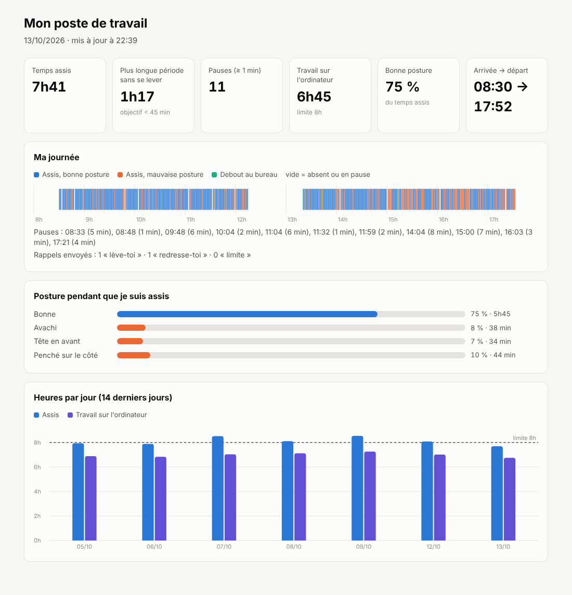

# ASSaiS – ton poste de travail sous surveillance bienveillante

ASSaiS utilise la **webcam de ton PC** pour t'aider à mieux travailler assis :

- **Posture** : te dit quand tu t'avachis, et peut te le rappeler toutes les 15 s tant que tu ne t'es pas redressé.
- **Temps assis** : mesure combien de temps tu restes sans te lever, et te rappelle de bouger.
- **Temps de travail** : compte ton temps sur l'ordinateur, avec une limite par jour.
- **Yeux** : te rappelle la règle 20-20-20 (toutes les 20 min, regarder au loin 20 s).
- **Rapport du jour** : frise de ta journée, pauses, posture, et historique sur 14 jours.

**Confidentialité :** tout est analysé sur ton PC. Aucune image n'est enregistrée ni envoyée sur Internet : seules des statistiques (durées, postures) sont gardées, dans ton dossier utilisateur.

---

## Télécharger et installer

1. Va sur la page **[Releases](https://github.com/lumios-le-jeu/ASSaiS/releases)** et télécharge **`ASSaiS_Setup.exe`**, version la plus récente, rubrique **Assets**.
2. Double-clic sur **`ASSaiS_Setup.exe`**, puis **Suivant**.
   - Pas besoin de droits administrateur, ni d'installer Python.
   - Coche **« Lancer ASSaiS automatiquement »** pour qu'il démarre tout seul à l'ouverture de session, au déverrouillage et à la sortie de veille.
3. Lance **ASSaiS** depuis le menu Démarrer.

> **« Windows a protégé votre ordinateur » ?** Ce message s'affiche parce que l'installeur n'est pas signé numériquement. Clique sur **Informations complémentaires**, puis **Exécuter quand même**.

**Configuration requise :** Windows 10 ou 11, une webcam (intégrée ou USB), environ 500 Mo d'espace disque.

---

## Première utilisation : 2 clics

ASSaiS compare ta posture à **deux repères que tu lui montres** :

1. Assieds-toi **bien droit**, puis clique **Droit**. Ne bouge pas pendant 3 s.
2. Avachis-toi **comme d'habitude**, puis clique **Avachi**. Ne bouge pas pendant 3 s.

Sur l'image apparaissent :

- une ligne en pointillés **verts « DROIT »** ;
- une ligne en pointillés **orange « AVACHI »** ;
- un trait **blanc « MOI »**, à la hauteur actuelle de tes épaules.

Dès que tes épaules dépassent la moitié du chemin vers AVACHI, l'état passe en **AVACHI**. La **jauge** en bas à droite te montre où tu en es.

Conseils :

- Ta webcam doit voir **tes deux épaules**.
- **Exagère un peu** la posture avachie : plus les deux lignes sont écartées, plus la mesure est fiable.
- Refais les deux clics si tu déplaces la webcam ou la chaise.

---

## Boutons et touches

| Bouton | Touche | Action |
|---|---|---|
| **Droit** | `C` | Enregistre ta posture **droite** |
| **Avachi** | `A` | Enregistre ta posture **avachie** |
| **Rapport** | `R` | Ouvre le rapport du jour dans ton navigateur |
| **Visio** | `M` | Libère la webcam pour une visio, ou la reprend |
| case **Alerte posture** | `P` | Notification dès que tu n'es plus droit, puis toutes les 15 s |
| – | `S` | Affiche ou masque le squelette |
| – | `Q` | **Quitte** ASSaiS (tes statistiques sont enregistrées) |

---

## Ce qu'ASSaiS fait pour toi

### Rappels automatiques (notifications Windows)

| Rappel | Quand |
|---|---|
| **Lève-toi !** | assis depuis 45 min sans vraie pause |
| **Pause des yeux** | toutes les 20 min d'écran : regarde au loin pendant 20 s |
| **Redresse-toi** | mauvaise posture depuis 2 min, ou toutes les 15 s si la case **Alerte posture** est cochée |
| **Limite atteinte** | 8 h de travail dans la journée |

Une **vraie pause**, c'est au moins 1 min debout ou loin du bureau. Le **temps de travail**, c'est le temps où tu es assis **et** actif au clavier ou à la souris.

### Visio (Teams, Zoom, Meet…)

Une webcam ne peut servir qu'à une application à la fois.

- **Avant ta visio**, clique **Visio** : ASSaiS libère la webcam.
- Si la visio a pris la webcam en premier, ASSaiS passe **tout seul** en mode visio.
- Pendant la visio, le temps compte comme assis et travail. La posture n'est pas mesurée.
- Environ **20 s après la fin**, ASSaiS reprend la webcam tout seul.

### Le rapport du jour

Bouton **Rapport**, ou menu Démarrer → **ASSaiS – rapport du jour**. Il contient :

- les **chiffres clés** : temps assis, plus longue période sans se lever, pauses, travail sur l'ordinateur, pourcentage de bonne posture, heures d'arrivée et de départ ;
- la **frise de ta journée**, minute par minute :
  - bleu = bonne posture ;
  - orange = mauvaise posture ;
  - vert = debout ;
  - violet = en visio ;
- la **répartition de ta posture** : bonne, avachi, tête en avant, penché sur le côté ;
- l'**historique des 14 derniers jours**.

---

## Où sont mes données ?

Dans **`%LOCALAPPDATA%\ASSaiS`** : colle ce chemin dans la barre d'adresse de l'Explorateur.

| Fichier | Contenu |
|---|---|
| `AAAA-MM-JJ.json` | les statistiques d'une journée |
| `calibration_webcam0.json` | tes repères DROIT / AVACHI |
| `rapport.html` | le rapport |
| `assis.log` | le journal de fonctionnement |

---

## Mettre à jour

Quitte ASSaiS (touche `Q`), télécharge le nouveau `ASSaiS_Setup.exe` sur la page [Releases](https://github.com/lumios-le-jeu/ASSaiS/releases), puis lance-le. **Tes données et tes calibrations sont conservées.**

## Désinstaller

**Paramètres → Applications → ASSaiS → Désinstaller.** Le lancement automatique est supprimé lui aussi. Tes données restent dans `%LOCALAPPDATA%\ASSaiS` : supprime ce dossier pour tout effacer.

---

## Dépannage

| Problème | Solution |
|---|---|
| « Calibration ratée : je ne vois pas tes épaules » | Recule un peu ou ajuste la webcam : tes **deux épaules** doivent être visibles. |
| Toujours « BONNE » alors que je suis avachi | Refais **Droit** puis **Avachi** en exagérant davantage la posture avachie. |
| Ma visio ne trouve pas la webcam | Clique **Visio** dans ASSaiS. |
| La webcam n'est pas reprise après la visio | Clique **Fin visio**. |
| Les boutons ne réagissent pas | Clique d'abord dans la fenêtre ASSaiS pour la rendre active. |
| ASSaiS ne démarre pas tout seul | Réinstalle en cochant **« Lancer ASSaiS automatiquement »**. |
| ASSaiS ne s'ouvre pas | Il est peut-être déjà ouvert : il ne tourne qu'en un seul exemplaire. Sinon, regarde `%LOCALAPPDATA%\ASSaiS\assis.log`. |
